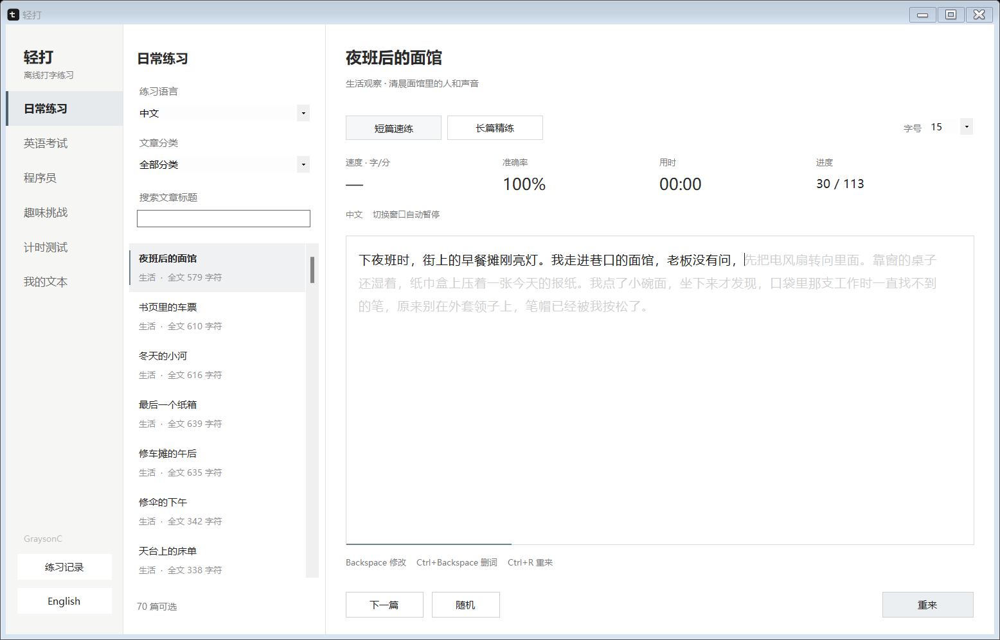
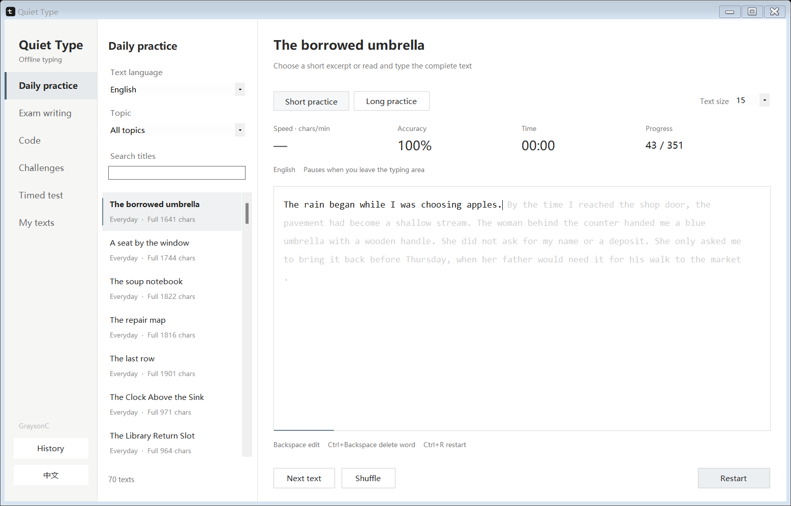

# 轻打 / Quiet Type · Typing practice

[中文](#中文) · [English](#english)

[Windows · exe](https://github.com/wind884/quiet-type/releases/latest/download/QuietType.exe) · [macOS · dmg](https://github.com/wind884/quiet-type/releases/latest/download/QuietType.dmg) · [全部下载 / All downloads](https://github.com/wind884/quiet-type/releases/latest)

## 中文

适用于 Windows 和 macOS 的离线打字练习与打字测速工具，支持中文、英文和自定义语言

浅灰色原文留在白色输入区里，输入的黑字在同一位置盖上去，哪里打错、还剩多少，一眼就能看到



### 什么时候用

- 换了键盘或输入法，花几分钟找回手感
- 想练英文输入，也想顺便熟悉一篇文章
- 备考时反复敲一段英语范文，减少键盘和拼写上的卡顿
- 把自己的笔记、演讲稿或外语文章导入，练平时真正会用到的文字
- 写代码之前热一下手，或者和计时器、影子对手比一场

### 可以练什么

**日常练习**有中英文各 70 篇文章，按生活、旅行、自然、科学、城市、人物、饮食和微悬疑分类，另有日语、韩语、法语、西班牙语、德语和俄语样例

**英语考试**收录 IELTS 图表与议论文、TOEFL 邮件与学术讨论、四六级写作练习，文章上方保留题目背景，范文用于打字练习，不是官方答案

**程序员**提供 Python、JavaScript、C#、SQL 和 HTML / CSS，保留代码里的符号、换行和缩进

**计时测试**可选 30 秒到 5 分钟，从第一次输入开始计时，结束后查看速度、准确率和成绩记录

**我的文本**可以粘贴文字或导入 TXT，自行填写语言名称，原文件不会被改动

每组内容都有短篇和长篇，共 201 组内置练习，标题支持中英文搜索，也可以随机换一篇

### 想换个玩法

五种挑战都有中文、英文和不同场景

| 玩法 | 规则 |
| --- | --- |
| 连击闯关 | 连续正确提高得分倍率，准确率达到 90% 才能过关 |
| 一命通关 | 打错第一个字符，本轮就结束 |
| 记忆闪打 | 先看几秒原文，再藏起来默打，偷看次数有限 |
| 影子赛跑 | 对手按设定速度前进，要在它到达之前正确完成 |
| 错字复仇 | 从自己的错词里出题，改对后移出清单，中英文分别练 |

### 开始使用

Windows 下载 exe 后直接打开，不需要安装

macOS 打开 dmg，把 Quiet Type 拖进 Applications，安装包同时包含 Apple Silicon 和 Intel 程序

macOS 安装包未做 Apple 公证，首次打开可能被系统拦截，确认下载来源后，可在系统设置的「隐私与安全性」中允许打开

左侧选练习类型，中间选语言、分类和文章，右侧选短篇或长篇，点击白色区域开始输入

左下角的中文 / English 按钮只切换界面语言，不会换文章或清空当前输入，练习文章的语言在中间单独选择

普通练习离开输入区时暂停，计时测试和影子赛跑继续计时

Windows 用 Ctrl，macOS 用 Command：R 重来、N 下一篇，Backspace 修改；代码里用 Enter 换行、Tab 缩进

中文和其他语言使用系统输入法，暂不支持从右向左排版的文章

### 本机数据

不用注册账号，文章、成绩和错词保存在自己的电脑里

- Windows：`%LOCALAPPDATA%\QuietType\userdata.xml`
- macOS：`~/Library/Application Support/QuietType/userdata.json`

### 反馈问题

安装、输入法或练习过程中遇到问题，可以[提交 Issue](https://github.com/wind884/quiet-type/issues/new)，写上系统、操作步骤和实际结果，方便复现

### 从源码构建

Windows 在 PowerShell 运行：

```powershell
./windows/build.ps1
./windows/test.ps1
```

macOS 安装 Xcode Command Line Tools 后运行：

```sh
sh macos/build.sh
sh macos/test.sh
```

程序分别使用 Windows Forms 和 AppKit，没有额外的第三方运行库，两个平台共用 `content/lessons.json`

构建结果在 `dist/`，GitHub Actions 会检查两个平台并生成可下载的程序

## English

Offline typing practice and typing tests for Windows and macOS, with Chinese, English, and custom languages

The passage appears in light gray on a white typing area. As you type, black characters cover the original text in the same positions, so you can see your mistakes and how much is left.



### When to use it

- Get used to a new keyboard or input method with a few minutes of practice
- Practice English typing while getting familiar with a passage
- Type out sample essays during exam preparation to work on spelling and keyboard fluency
- Import your notes, speeches, or foreign-language passages and practice text you actually use
- Warm up before coding, or race against a timer or a ghost opponent

### What you can practice

**Daily practice** includes 70 English and 70 Chinese passages about everyday life, travel, nature, science, cities, people, food, and short mysteries. There are also sample passages in Japanese, Korean, French, Spanish, German, and Russian.

**Exam writing** includes IELTS chart descriptions and essays, TOEFL emails and academic discussions, and writing practice for China's College English Test, CET-4 and CET-6. Each passage keeps its writing prompt above the text. The samples are for typing practice and are not official exam answers.

**Code** offers Python, JavaScript, C#, SQL, and HTML / CSS, with punctuation, line breaks, and indentation preserved.

**Timed test** runs from 30 seconds to 5 minutes. The clock starts with your first input. When time is up, you can check your speed, accuracy, and result history.

**My texts** lets you paste text or import a TXT file and enter your own language name. Importing leaves the original file unchanged.

All 201 built-in lessons have short and long passages. You can search titles in Chinese or English, or pick a random lesson.

### Try a challenge

All five challenges have Chinese and English passages with several scenarios to choose from.

| Challenge | How it works |
| --- | --- |
| Combo run | Build a streak to raise your score multiplier, then finish with at least 90% accuracy to pass |
| One life | The first wrong character ends the round |
| Memory flash | Read the passage for a few seconds, then type it from memory with a limited number of peeks |
| Ghost race | Finish the passage correctly before an opponent moving at your chosen pace reaches the end |
| Mistake rematch | Practice words from your own mistakes and clear them from the list by getting them right, with separate lists for Chinese and English |

### Getting started

On Windows, download and open the exe. No installation is needed.

On macOS, open the dmg and drag Quiet Type into Applications. The same download supports Apple Silicon and Intel Macs.

The macOS app is not notarized by Apple. If macOS blocks it on first launch, check that you downloaded it from this repository, then allow it in System Settings → Privacy & Security.

Choose a practice type on the left, then a language, category, and passage in the middle. Select short or long practice on the right and click the white typing area to begin.

The 中文 / English button in the lower-left corner only changes the interface language. It keeps your passage and current input. Choose the language of the practice text separately in the middle panel.

Ordinary practice pauses when you leave the typing area. Timed tests and ghost races keep running.

Use Ctrl on Windows and Command on macOS: R to restart and N for the next passage. Use Backspace to edit, and Enter and Tab for line breaks and indentation in code.

Use your system input method for Chinese and other languages. Passages written from right to left are not supported yet.

### Your data

No account is needed. Your texts, results, and mistake lists stay on your computer.

- Windows: `%LOCALAPPDATA%\QuietType\userdata.xml`
- macOS: `~/Library/Application Support/QuietType/userdata.json`

### Questions and feedback

If installation, an input method, or a practice session goes wrong, [open an issue](https://github.com/wind884/quiet-type/issues/new) with your operating system, the steps you took, and what happened.

### Building from source

On Windows, run these commands in PowerShell:

```powershell
./windows/build.ps1
./windows/test.ps1
```

On macOS, install Xcode Command Line Tools, then run:

```sh
sh macos/build.sh
sh macos/test.sh
```

The Windows app uses Windows Forms and the macOS app uses AppKit, with no additional third-party runtime libraries. Both platforms share `content/lessons.json`.

Build output goes into `dist/`. GitHub Actions checks both platforms and packages the downloads.
